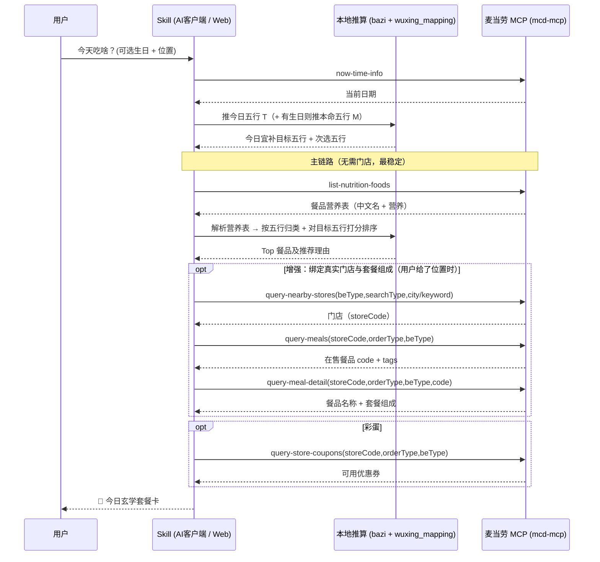

# 麦当劳 MCP 集成说明

本文件说明「麦麦赛博算命 Skill」**实际使用**的麦当劳 MCP Server、调用的 Tool、
调用流程与业务价值，供参赛资格核验参考。

---

## 一、使用的 MCP Server

- **Server 名称**：`mcd-mcp`（麦当劳中国官方 MCP Server）
- **接入地址**：`https://mcp.mcd.cn`
- **传输协议**：Streamable HTTP
- **鉴权方式**：请求头 `Authorization: Bearer <MCP_TOKEN>`
- **配置示例**：见 [`mcp-config.example.json`](./mcp-config.example.json)（仅环境变量占位符 `${MCD_MCP_TOKEN}`）
- **限流**：600 次/分钟（超限返回 429）；Token 无效返回 401。

本项目通过两种路径使用上述 Server：

1. **纯 Skill 路径**（主体）：由支持 MCP 的 AI 客户端按 [`SKILL.md`](./SKILL.md) 的
   指令直接调用 `mcd-mcp` 的工具。
2. **本地代理路径（可选）**：由本地 FastAPI 代理 [`src/proxy_server.py`](./src/proxy_server.py)
   注入 `Authorization` 后转发到 `https://mcp.mcd.cn`，供自建前端或二次开发使用
   （Token 从环境变量读取，不入前端/仓库）。

---

## 二、实际调用的 Tool 列表

| # | Tool | 本 Skill 的用途 | 必填参数（经真实核验） | 必需性 |
|---|---|---|---|---|
| 1 | `now-time-info` | 获取**当前日期**，作为「今日干支/今日五行」的推算输入。严禁凭记忆编造日期。 | 无 | 必需 |
| 2 | `list-nutrition-foods` | 返回**含中文名 + 完整营养**的餐品营养表（能量/蛋白/脂肪/碳水/钠/钙），是「营养为主」五行归类的**主数据源**。 | 无 | 必需（真实数据主链路） |
| 3 | `query-nearby-stores` | 用用户位置查附近门店，取 `storeCode` 作为门店上下文。 | `beType`、`searchType`、`city`/`keyword` | 可选（增强：绑定真实门店） |
| 4 | `query-meals` | 查门店可售餐品（返回 `data.categories[].meals[].{code,tags}`，仅编码+标签）。 | `storeCode`、`orderType`、`beType` | 可选（增强） |
| 5 | `query-meal-detail` | 查餐品**名称与套餐组成**（`data.name`、`data.rounds[].choices[]`）。 | `storeCode`、`orderType`、`beType`、`code` | 可选（增强：套餐组成） |
| 6 | `query-store-coupons` | 查门店可用优惠券，作为套餐卡的「今日财运加持券」彩蛋。 | `storeCode`、`orderType`、`beType` | 可选（彩蛋） |

> **真实结构要点**（已用有效 Token 核验）：
> - `list-nutrition-foods` 的 `data` 是一段文本表：首行 `[N]{productName,...,energyKcal,protein,fat,carbohydrate,sodium,calcium}:`，其后每行一条餐品。它同时含名称与营养，故作为五行归类打分的首选来源，且无需门店、最稳定。
> - `query-meals` 只返回 `code`+`tags`、**不含名称与营养**；要落到「某门店真实在售 + 套餐组成」，需用其 `code` 再调 `query-meal-detail`。
> - 到店自提（`orderType=1`）场景下 `beCode` 为无效参数，不传。
>
> 降级：当连 `list-nutrition-foods` 都不可用（如 Token 无效/缺失）时，Skill 会**降级为五行象征推荐**并明确标注「非实时数据」，保证流程不中断。

---

## 三、调用流程

对应代码/指令位置：

- 日期与真实数据：全部来自 `mcd-mcp` 工具调用；
- 五行推算：[`src/bazi.py`](./src/bazi.py)（`analyze()` / `get_day_pillar()` 等）；
- 营养表解析 + 五行归类排序：[`src/wuxing_mapping.py`](./src/wuxing_mapping.py)（`parse_nutrition_table()` / `recommend()`）；
- 编排指令：[`SKILL.md`](./SKILL.md) 第五节「执行流程」；
- 真实数据一站式端点：[`src/proxy_server.py`](./src/proxy_server.py) 的 `/api/real-recommend`（内部编排上述主链路），以及通用转发 `/api/mcp/tool/{tool_name}`。

---

## 四、业务价值

1. **把 MCP 的真实能力变成一次有记忆点的体验**：不是干巴巴地查菜单，而是用
   「八字五行」这层趣味外壳，驱动 `now-time-info`→`query-meals`→`list-nutrition-foods`
   →`query-meal-detail` 的真实数据链路，输出一张可分享的运势套餐卡。
2. **降低点餐决策成本**：为「选择困难」用户用一个轻松的理由收敛选项——
   今日宜补什么五行，就从真实在售菜单里挑对应的餐品，并给出套餐组成。
3. **可直接转化**：推荐基于真实门店菜单与套餐组成，天然贴近下单；配合
   `query-store-coupons` 还能把优惠一并呈现，形成「算一卦 → 看套餐 → 领券」的闭环。
4. **传播性**：五行运势卡片形式适合社交分享，为麦当劳 MCP 带来趣味向的曝光场景。

---

## 五、鉴权与安全

- Token 仅通过**环境变量** `MCD_MCP_TOKEN` 提供；仓库内不含任何真实 Token。
- Web 场景下，Token 只存在于本地代理进程的环境变量中，经代理注入
  `Authorization` 头后转发，**不下发到浏览器前端**，规避泄露与 CORS 问题。
- 代理对 401（Token 失效）/ 429（限流）返回清晰可读的错误提示，便于排查。
